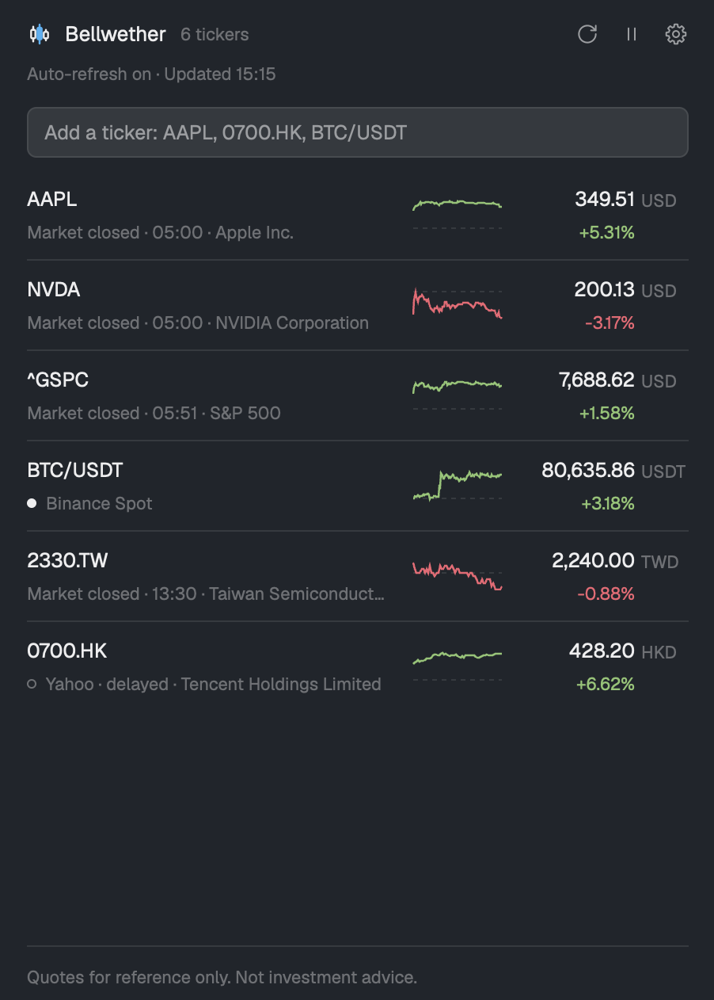

<p align="center">
  <picture>
    <source media="(prefers-color-scheme: dark)" srcset="assets/logo-dark.svg">
    
  </picture>
</p>

<h1 align="center">Wickline</h1>

<p align="center">Stock and crypto quotes beside your agents in Herdr — honest about what is live and what is delayed.</p>

<p align="center">English · <a href="README.zh-TW.md">繁體中文</a></p>

<p align="center">
  <a href="LICENSE"></a>
  <a href="https://herdr.dev/mods"></a>
  <a href="https://github.com/jordan13p/wickline/actions/workflows/checks.yml"></a>
</p>



## Highlights

- One source per market: Yahoo Finance for stocks and indexes, Binance Spot for crypto, and real time for Taiwan (Yahoo TW Stock, TWSE MIS) or US stocks (Finnhub, your own key) only if you turn it on.
- Live or delayed at a glance: every row says where its price comes from and how old it is; a delayed or cached price never looks live.
- Five interface languages: English, 繁體中文, 简体中文, 日本語 and 한국어, with red-up or green-up colors.
- Drag a row to reorder the list; every open copy follows at once.
- No telemetry, no server in between: requests go straight from your computer to each source. The only program run is `chmod 600` on the key file when you save a Finnhub key (macOS and Linux).
- Follows your Herdr theme, light or dark, and its width: a sidebar below 720 px, a table from 720 px (it opens wide in its own tab), a one-line band under 72 px tall.

## Markets and sources

| Market | Default | Optional real-time | Notes |
|---|---|---|---|
| United States | Yahoo Finance (delayed) | Finnhub, with your own API key | Finnhub prices the first 15 US symbols at its default budget of 60 requests per minute; the rest stay on Yahoo. |
| Taiwan | Yahoo Finance (delayed 20 min) | Yahoo TW Stock (Yahoo 奇摩股市) and TWSE MIS, each off until you consent to it | Neither is a public interface. A live Yahoo TW Stock price comes first, then MIS; a price outside the stock's daily limits is discarded and the row shows the next source. |
| Hong Kong, China, Japan, Korea | Yahoo Finance (delayed) | — | Delays vary by exchange; Yahoo usually does not report them. |
| Crypto | Binance Spot (real time) | — | Binance is unavailable in some regions, such as the United States; you can set another address that serves the same API. |

Each row has a dot and a label:

- **Filled dot**: live. A real-time source, the market trading, the quote at most 120 seconds old; the label says `Live`, and the source's name is in the detail view.
- **Ring**: delayed or stalled. Yahoo's prices (`delayed 20 min`, `Yahoo · delayed`), a real-time quote older than 120 seconds (`quote stopped at 13:05`), or a session not known yet.
- **No dot**: the market is closed or outside its regular session (`Market closed · Oct 31 16:00`, `Pre-market`, `After hours`).

Each source refreshes on its own: Yahoo every 60 seconds, Binance every 15 seconds, Yahoo TW Stock and TWSE MIS every 10 seconds while Taiwan trades (60 otherwise), Finnhub about every 30 seconds per symbol while the US market trades. A source that fails or is rate limited backs off and its rows say why, while the others carry on.

## Install

Ask the agent in Herdr:

```text
Read ~/.config/herdr-app/AGENTS.md, then add this mod: https://github.com/jordan13p/wickline
```

The agent tells you what Wickline reaches on the network, copies the mod, merges its `keys.json` (it asks before replacing a key you already use) and checks it.

<details>
<summary>Install by hand</summary>

1. Copy `mods/wickline/` to `~/.config/herdr-app/mods/wickline/`. Its `mod.json` says `"place": "none"`, so your layouts stay as they are.
2. Add the line from this repo's `keys.json` to the `global` section of `~/.config/herdr-app/keys.json`. Editing that file keeps it as yours: Herdr no longer adds new default shortcuts to it on upgrade.
3. Check it:

   ```sh
   herdr-app check ~/.config/herdr-app/mods/wickline
   ```

4. Open it with `ctrl-alt-b`, or without the key, on Herdr's `main` layout or your own:

   ```sh
   herdr-app do pane.split --direction right --mod wickline
   ```

</details>

## Usage

Type a symbol into the add field and press Enter; a new symbol goes to the top of the list:

| Symbol | Market |
|---|---|
| `AAPL` | US stock |
| `^GSPC` | index (S&P 500) |
| `2330.TW` | Taiwan stock (`.TWO` for the OTC market) |
| `0700.HK` | Hong Kong stock (`700.HK` works too) |
| `7203.T` | Japan stock |
| `BTC/USDT` | Binance crypto pair, `BASE/QUOTE` |

- **Remove**: hover a row and press `×` at its right; the notice offers **Undo** for 10 seconds.
- **Filter by market**: with at least 8 symbols from at least 2 markets, a row above the list shows `All` and each market with its count (`All 12 · US 4 · Taiwan 5 · Crypto 3`), in a fixed order for the interface language, never the order of your list (Traditional and Simplified Chinese put Taiwan first, English the US, Japanese Japan, Korean Korea); click one to show only that market. The band never shows it. Each copy remembers its own choice; adding a symbol the filter would hide, or removing a market's last symbol, puts it back on `All`.
- **Reorder**: hover a row, press the six-dot handle at its left and drag; an accent line shows where it lands. Leaving the list cancels the drag.
- **Detail**: click a row for its day: a chart, open, high, low and previous close, the session, the price's state and source (`Live · TWSE MIS`), the line's, the quote time, the last trade (Yahoo TW Stock) and the fetch time.
- **Refresh and Pause**: the header icons. Refresh runs one round of every source but Finnhub, also while paused; Pause stops automatic refreshes in every copy.
- **Keys**: Wickline answers `wickline.refresh` and `wickline.pause`; neither is bound. To bind one, add it to `~/.config/herdr-app/keys.json`:

  ```json
  { "global": { "ctrl-alt-r": "wickline.refresh" } }
  ```

### Open and close

- `ctrl-alt-b` opens Wickline as a pane to the right of the focused terminal, on any layout. Pressing it again opens another copy, and every copy sends its own requests, so keep one open.
- To change the key, rename `ctrl-alt-b` in the `global` section of `~/.config/herdr-app/keys.json`; to drop it, delete that line. Without a key: `herdr-app do pane.split --direction right --mod wickline`.
- Close it like any pane, from Herdr's pane header or with `pane.close`.
- The header's **open in its own tab** icon moves Wickline to a `Wickline` tab, wide enough for the table; there, **back beside the terminal** puts it back to the right of a pane in the tab it came from and closes only its own pane (the tab too, when it held nothing else; a shell you split in there stays). The old copy closes only once the new one is open, so a refused move leaves everything as it was. Only one copy fetches either way. In the docked side panel the same icon opens the tab and then collapses the panel; in that tab, **back to the panel** opens the panel on Wickline again, returns you to the tab you were on, and closes the tab's Wickline pane (the tab too, when it held nothing else; a shell you split in there stays). While that tab is open, the panel shows only a line saying so, with a **back to the panel** button, and sends nothing; a Wickline pane opened another way never makes the panel step aside.
- Zoom stays with Herdr's own pane header; Wickline has no zoom of its own.
- **Dock it in your own layout**: Wickline can also be a block in a layout of yours, for example in the stack that holds Files and Changes. `"props": {"card": true}` gives it the rounded, bordered card those side panels draw; a pane doesn't need it, since Herdr already frames panes:

  ```json
  { "id": "wickline", "type": "block", "content": { "mod": "wickline", "props": { "card": true } } }
  ```

## Settings

The gear icon opens a dialog with a sidebar: a page for each market under **Data sources** (in your interface language's market order, each marked `● Live` or `○ Delayed` by what your unsaved choices would use), then **Display** and **Disclaimer & privacy**. It opens on the first market page. Nothing changes until you press Save; Cancel or Esc drops your edits, and the footer names whatever keeps Save disabled, even on another page.

**Market pages.** Every page has the same shape: its title with the state and source it would use, the real-time sources in order, each with a switch, then what is used when none works (Yahoo Finance and its delay, always on). **United States**: Finnhub, with your own API key (a free-plan key is enough), the requests per minute and how many symbols that covers. A saved key is never shown again: the page says `Saved ••••` with its last four characters and a **Remove** button, also while Finnhub is off; leave the field empty to keep it, or type a new key to replace it. **Taiwan**: 1 Yahoo TW Stock, 2 TWSE MIS, both off at first; each runs only after you read its own statement and tick its own consent box, and once that consent is saved its row folds to one line, `✓ Consented · View`, whose link reads **Hide** in place while the statement shows. **Crypto**: Binance Spot, always on, with no fallback. **Other markets**: Yahoo Finance only. A source's current problem shows under its row. The addresses sit under **Advanced**, folded until you open it or one of them is refused: the TWSE MIS and Binance addresses (`https://` only) and the Finnhub URL, which stays on `https://finnhub.io` (only its path can change).

**Display.** The interface language (it changes only the text, not the quotes), the gain and loss colors (automatic by language, red-up or green-up) and a button to Herdr's own appearance settings; light and dark themes come from Herdr.

The 简体中文, 日本語 and 한국어 texts are machine-translated and not yet reviewed by native speakers; corrections are welcome as an issue or a pull request.

**Disclaimer & privacy.** The full disclaimer, what each source's quotes mean, and the hosts, programs and storage listed below. The one-line disclaimer in the panel footer opens this tab.

## Privacy and security

Hosts, and when Wickline contacts them:

| Host | When |
|---|---|
| `query1.finance.yahoo.com` | always, for stocks and indexes |
| `data-api.binance.vision`, or the Binance address you set | always, for crypto pairs |
| `tw.stock.yahoo.com` (fixed) | only after you turn on Yahoo TW Stock for Taiwan and tick its consent box (not a public interface) |
| `mis.twse.com.tw`, or the MIS address you set | only after you turn on TWSE MIS for Taiwan and tick its consent box (unofficial) |
| `finnhub.io` (only the path of the Finnhub URL can change) | only after you choose Finnhub for US stocks and save a key; the key travels in a request header, never in the address, and only to `https://finnhub.io`: a saved address on any other host, or an answer redirected elsewhere, stops Finnhub and says so |

- **Programs**: only `chmod 600` on `data/wickline/secrets.json` right after you save a Finnhub key, on macOS and Linux, so other accounts on this computer cannot read it. If it fails, the dialog says so and the key stays saved. Nothing else is run.
- **Storage**: the watchlist in Herdr's shared state under `wickline.watchlist.v1`, the settings under `wickline.settings.v1`, and the tab a docked panel opened Wickline in under `wickline.dockTab` (so the panel can step aside while it is open). Each open copy also keeps its chosen market filter, and nothing else, under `wickline.filter` in its own `localStorage`, a file under `data/wickline/` in Herdr's folder. A Finnhub key you save is kept in plaintext in `data/wickline/secrets.json` in Herdr's folder on this computer, never in the shared state. On macOS and Linux the file is readable by your account only; any program running as you (another Herdr mod included) can still read it, so use a free-plan key. To remove the key, press **Remove** on the United States page and save (the file is deleted and every copy drops the key within one refresh), or delete that file; turning Finnhub off alone keeps it. Backups such as Time Machine may still hold an old key: to revoke it for good, regenerate the key on Finnhub. No other file is read or written.
- **Finnhub**: only the first US symbols your budget covers are asked (15 at the default 60 requests per minute). Every open copy sends its own requests, so two copies use the budget twice as fast.
- No telemetry, no analytics and no intermediate server: requests go directly from this computer to each source.
- Keep one copy of Wickline open. Each copy, even one in a background tab, runs its own refresh loops, so a second copy doubles every request. A docked block that is not shown sends nothing, and, when shown again, fetches at once in the sources that skipped a round while it was hidden.

## FAQ

**Why are my Taiwan quotes 20 minutes late?** Yahoo Finance delays Taiwan quotes by 20 minutes, and Wickline says so on every Taiwan row (`delayed 20 min`). For real-time Taiwan prices, turn on Yahoo TW Stock or TWSE MIS in Settings.

**Why is TWSE MIS off by default?** TWSE MIS is the Taiwan Stock Exchange's market-information website, not an API offered to third-party programs, and nothing about it is promised. Wickline uses it only after you read its responsibility statement in Settings and tick the consent box; whether to use it, and whether that complies with the exchange website's terms of use, is your own judgment and responsibility. The Traditional Chinese statement prevails.

**Why is Yahoo TW Stock off by default?** Its quote interface is one that tw.stock.yahoo.com uses internally, not offered publicly to third-party programs, and the site's robots.txt disallows automated access to it; it may change, be blocked or stop at any time. When on, it is asked for prices about every 10 seconds while the market is open (about every 60 seconds otherwise) and for each stock's intraday chart about every 2 minutes (otherwise about every 10 minutes until the day's chart is complete). Wickline uses it only after you read its own responsibility statement in Settings and tick its consent box; whether to use it, and whether that complies with Yahoo's terms of service, is your own judgment and responsibility. The Traditional Chinese statement prevails.

**Why only 15 real-time US symbols?** Finnhub's free plan allows 60 requests a minute. Wickline prices as many US symbols as your budget divided by 4, so each symbol refreshes about every 30 seconds with half the budget left for retries and a second copy. The first US symbols in your list get Finnhub; the rest show Yahoo and say they are over the limit. Raise the requests per minute in Settings if your plan allows more.

**Why is Binance unavailable for me?** Binance refuses requests from some regions, such as the United States, and the crypto rows then say Binance is not available in this region. Stocks are unaffected. You can set another Binance address that serves the same API in Settings.

**Does Wickline send my watchlist anywhere?** No. Each symbol goes only to the source that prices it, as part of that source's request, directly from your computer. There is no Wickline server and no telemetry; the list itself stays in Herdr's shared state on this computer.

## Disclaimer

Quotes come from third parties and are not guaranteed to be accurate, timely or available. Nothing shown here is investment advice. Turning on a source that is not public, or entering a key, is your own act and is governed by that source's terms. Requests go directly from this computer to each source. Wickline has no server and sends no telemetry. A Finnhub key you save is stored in plaintext on this computer. The English text prevails over its translations.

## Credits and license

Wickline is a modified version of the Herdr mod in [fatwang2/Pulse](https://github.com/fatwang2/Pulse) (MIT). It is not affiliated with or endorsed by Pulse.

Released under the [MIT License](LICENSE), copyright (c) 2026 fatwang2 and (c) 2026 jordan13p.

## Development

```sh
node --test tests/
herdr-app check "$PWD/mods/wickline"
```

`RECIPE.md` is the full brief: what Wickline draws, how it behaves and what it is built from.
