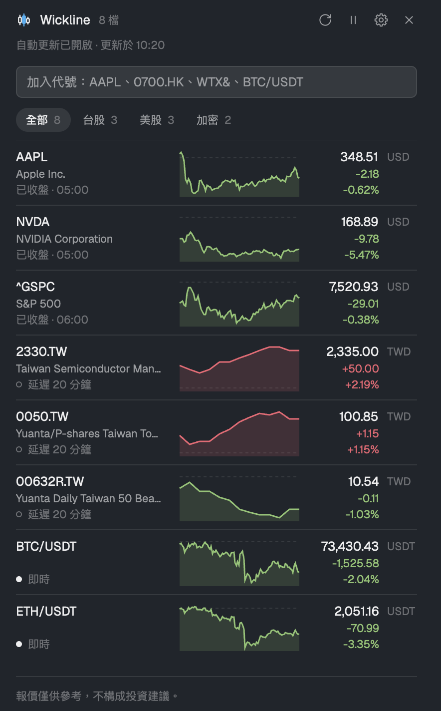

<p align="center">
  <picture>
    <source media="(prefers-color-scheme: dark)" srcset="assets/logo-dark.svg">
    
  </picture>
</p>

<h1 align="center">Wickline</h1>

<p align="center">在 Herdr 的 agent 旁看盤：哪些是即時、哪些是延遲，一眼分清楚。</p>

<p align="center"><a href="README.md">English</a> · 繁體中文</p>

<p align="center">
  <a href="LICENSE"></a>
  <a href="https://herdr.dev/mods"></a>
  <a href="https://github.com/jordan13p/wickline/actions/workflows/checks.yml"></a>
</p>



## 特色

- 每個市場各有來源：股票與指數用 Yahoo Finance（美股為即時報價，每分鐘更新），加密貨幣用 Binance Spot；台股的即時報價（Yahoo 奇摩股市、證交所 MIS）與美股約每 15–30 秒的更新（Finnhub，用你自己的 API 金鑰）需自行開啟。
- 即時或延遲一眼可辨：每一列都標示價格來源與新舊程度，延遲或快取的價格絕不會看起來像即時。
- 五種介面語言：English、繁體中文、简体中文、日本語與 한국어，可選紅漲綠跌或綠漲紅跌。
- 拖曳列即可調整順序，每個開啟的 copy 立即同步。
- 沒有遙測、沒有中繼伺服器：請求直接從你的電腦送到各個來源。唯一會執行的程式，是你儲存 Finnhub API 金鑰時對金鑰檔案執行的 `chmod 600`（macOS 與 Linux）。
- 跟隨你的 Herdr 佈景主題（淺色或深色）；版面依寬度而定：寬度小於 720 px 是側邊欄，720 px 以上是表格（在自己的分頁中開啟時會很寬），高度小於 72 px 時是單行報價列。

## 市場與資料來源

| 市場 | 預設 | 可選來源 | 說明 |
|---|---|---|---|
| 美股 | Yahoo Finance（美股與標普、道瓊、那斯達克指數為即時，每分鐘更新；Cboe、NYSE、羅素指數與 OTC 股票延遲 15–20 分鐘） | Finnhub（約每 15–30 秒更新），需你自己的 API 金鑰 | 股票報價兩者都是即時，Finnhub 只是更新得更頻繁。預設額度每分鐘 60 次時，Finnhub 提供清單中前 15 檔美股的報價，其餘與指數仍用 Yahoo Finance。Finnhub 落後時（例如因額度限制暫停），會改顯示不比它舊的 Yahoo Finance 報價。 |
| 台股 | Yahoo Finance（延遲 20 分鐘） | Yahoo 奇摩股市與證交所 MIS，各自同意後才會開啟 | 兩者都不是公開介面。即時的 Yahoo 奇摩股市價格優先，其次是 MIS；超出該股當日漲跌停範圍的價格會被捨棄，該列改顯示下一個來源。Yahoo 奇摩股市也提供台股指數（如加權指數 `^TWII`）的即時報價。Yahoo Finance 沒有的 `^TW…` 指數，例如櫃檯指數（`^TWOII`），需開啟並同意 Yahoo 奇摩股市才有報價，否則會顯示查無此代號。期貨如 `WTX&`（台指期近一）與 `WTX@`（台指期近二）只由 Yahoo 奇摩股市提供；未開啟或等待重新確認時，該列只顯示一行無法報價的原因。期貨在日盤（08:45–13:45）與夜盤（15:00–05:00）顯示即時，盤中沒有近期成交時顯示報價停滯，開盤後一直沒有成交時顯示 `今日無成交`，兩盤之間顯示已收盤與最後成交時間，夜盤沒有成交時則顯示已收盤並註明 `夜盤尚無成交`；證交所公布休市的平日顯示 `休市`，從 05:00 起，沒有夜盤延續到當天時從午夜起。這類代號一旦有過報價，某次更新失敗、回應中沒有它，或回應的價格不是即時資料時，會保留最後價格並標示為快取報價與原因；回應只有名稱時也保留最後價格。 |
| 港股、陸股、日股、韓股 | Yahoo Finance（延遲 15 或 20 分鐘） | — | 港股、陸股與日股延遲 15 分鐘，韓股 20 分鐘（台股 20 分鐘）。午休時段（東京 11:30–12:30、香港 12:00–13:00、上海與深圳 11:30–13:00，皆為當地時間）該列顯示 `午休`。Wickline 不認得的交易所顯示 `Yahoo · 延遲`，不提供延遲時間。 |
| 外匯 | Yahoo Finance（即時，每分鐘更新） | — | `EURUSD=X` 等匯率是參考報價，不是成交價。週五 22:00 到週日 22:00 UTC 外匯市場顯示已收盤。 |
| 期貨 | Yahoo Finance（延遲 10 分鐘） | — | `ES=F` 等期貨永遠不會顯示報價停滯，CME 每日的暫停交易時段也不會標示。 |
| 加密貨幣 | Binance Spot（即時） | — | 部分地區（例如美國）無法使用 Binance；可改設提供相同 API 的其他網址。 |

每一列都有一個圓點和一個標籤：

- **實心圓點**：即時。即時來源（美股、標普、道瓊與那斯達克指數及外匯的 Yahoo Finance 也算）、市場交易中，且報價在 120 秒內；標籤寫「即時」，來源名稱在詳細資料裡。
- **空心圓圈**：延遲或停滯。延遲交易所的 Yahoo 報價（`延遲 20 分鐘`、`Yahoo · 延遲`）、超過 120 秒的即時報價或超過延遲時間加 5 分鐘的延遲報價（`報價停在 13:05`；Yahoo Finance 報價的新舊以抓取當下計算，最早從當天開盤起算，超過 5 分鐘沒有再抓到也算停住），或開盤後仍停在前一交易日收盤價的即時 Yahoo Finance 報價（直到抓到當天第一筆成交）。
- **無圓點**：市場已收盤或不在一般交易時段（`已收盤 · 10/31 16:00`、`盤前`、`盤後`、`午休`），或證交所休市日期列出的台股平日（`休市 · 12/24 13:30`；開盤後看到成交則不算休市），或來源顯示開盤後沒有任何成交的台股平日（`今日無成交 · 11/10 13:30`：可能休市，也可能是來源停滯；狀態列會指出是哪個來源）。

**價格亮燈。** 台股價格剛好等於即時來源（證交所 MIS 或 Yahoo 奇摩股市）給的漲停價或跌停價時，價格會變成漲跌色的實心底，就像看盤軟體的漲停亮燈；滑鼠移上去顯示 `漲停 563.00`。期貨（如 `WTX&`）剛好等於來源給的漲跌停價時同樣會亮；期貨價格超出漲跌停範圍時照常顯示，不會被捨棄。漲跌停價一律取自來源、不自行推算，所以其他市場，以及只用 Yahoo Finance 的台股，都不會亮；報價停滯時，以及開盤前的試撮價格，也不會亮。

每個來源各自更新：Yahoo 每 60 秒，Binance 每 15 秒，Yahoo 奇摩股市與證交所 MIS 在台股交易時每 10 秒，Yahoo 奇摩股市在期貨日盤與夜盤也是（其他時間每 60 秒），Finnhub 在美股交易時每檔約每 15–30 秒。失敗或被限制頻率的來源會暫緩並在該列說明原因，其他來源照常更新。

## 安裝

在 Herdr 中請 agent 執行：

```text
Read ~/.config/herdr-app/AGENTS.md, then add this mod: https://github.com/jordan13p/wickline
```

agent 會先告訴你 Wickline 會連線到哪些主機，再複製 mod、合併它的 `keys.json`（取代你已在使用的按鍵前會先詢問）並檢查。

<details>
<summary>手動安裝</summary>

1. 將 `mods/wickline/` 複製到 `~/.config/herdr-app/mods/wickline/`。它的 `mod.json` 是 `"place": "none"`，所以你的 layout 不會被改動。
2. 將本 repo `keys.json` 中的那一行加到 `~/.config/herdr-app/keys.json` 的 `global` 區段。編輯過這個檔案後，它就算是你自己的：Herdr 升級時不會再自動加入新的預設快捷鍵。
3. 檢查：

   ```sh
   herdr-app check ~/.config/herdr-app/mods/wickline
   ```

4. 按 `ctrl-alt-b` 開啟；不用快捷鍵時，在 Herdr 的 `main` layout 或你自己的 layout 執行：

   ```sh
   herdr-app do pane.split --direction right --mod wickline
   ```

</details>

## 使用方式

在新增欄位輸入代號後按 Enter，新加入的代號會排在清單最上方：

| 代號 | 市場 |
|---|---|
| `AAPL` | 美股 |
| `^GSPC` | 指數（S&P 500） |
| `2330.TW` | 台股上市（上櫃用 `.TWO`） |
| `WTX&` | 台灣期貨（台指期近一；近二用 `WTX@`），僅由 Yahoo 奇摩股市提供 |
| `0700.HK` | 港股（輸入 `700.HK` 也可以） |
| `7203.T` | 日股 |
| `BTC/USDT` | Binance 加密貨幣交易對，格式為 `BASE/QUOTE` |

- **移除**：滑鼠移到某一列，按右側的 `×`。移除後，通知會提供 **復原**，10 秒內有效。
- **依市場篩選**：清單至少有 8 檔、涵蓋至少 2 個市場時，清單上方會出現一排篩選，列出「全部」與各市場及其檔數（`全部 12 · 台股 5 · 美股 4 · 加密 3`），順序依介面語言固定，不隨清單順序變動（繁體與簡體中文台股在前，英文美股在前，日文日股在前，韓文韓股在前），點一下只顯示該市場。指數（`^DJI`、`^TWII`）會在第一筆報價回來後，依它的交易所歸到對應市場。精簡橫條不會顯示。每個 copy 各自記住自己的選擇；加入的代號會被篩選藏起來，或移除某市場的最後一檔時，會回到「全部」。
- **調整順序**：滑鼠移到某一列，按住左側的六點把手拖曳；強調色線會標出落點。拖出清單即取消。
- **詳細資料**：點一下某一列即可查看當天的走勢圖、開盤、最高、最低與昨收（有即時來源的台股另列漲停價與跌停價）、交易狀態（期貨交易中顯示 `日盤交易中` 或 `夜盤交易中`）、價格與走勢各自的狀態與來源（`即時 · 證交所 MIS`）、以你所在時區顯示的交易時段、報價時間、最後成交（Yahoo 奇摩股市）與取得時間。
- **重新整理與暫停**：標題列的圖示。重新整理會讓 Finnhub 以外的每個來源立即更新一輪，暫停時也可以；暫停會停止每個 copy 的自動更新。
- **快捷鍵**：Wickline 接受 `wickline.refresh` 與 `wickline.pause` 兩個指令，預設都沒有綁定。要綁定時，加到 `~/.config/herdr-app/keys.json`：

  ```json
  { "global": { "ctrl-alt-r": "wickline.refresh" } }
  ```

### 開啟與關閉

- `ctrl-alt-b` 會在目前 focus 的終端機右側開一個 Wickline pane，任何 layout 皆適用。再按一次會多開一個 copy，而每個 copy 都會各自發出請求，所以請只開一個。
- 要改按鍵，把 `~/.config/herdr-app/keys.json` `global` 區段中的 `ctrl-alt-b` 改掉；不要這個按鍵，就刪掉那一行。不用快捷鍵時：`herdr-app do pane.split --direction right --mod wickline`。
- 關閉方式和其他 pane 一樣：用 Herdr 的 pane 標題列，或執行 `pane.close`。
- 標題列的 **在自己的分頁開啟** 圖示會把 Wickline 移到名為 `Wickline` 的分頁，那裡夠寬，會顯示表格；在那裡按 **回到側邊**，會把它放回原分頁中某個 pane 的右側，並只關閉它自己的 pane（分頁裡沒有其他 pane 時，分頁也會一起關閉；你在那裡另外分割出的 shell 會保留）。新的 copy 確實開啟後才會關閉舊的，所以移動失敗時一切維持原樣。無論哪種方式，都只有一個 copy 在抓報價。在停靠的側邊面板裡，同一個圖示會開啟分頁，然後收合面板；在那個分頁裡，按 **回到面板** 會讓面板重新顯示 Wickline、回到你原本所在的分頁，並關閉分頁裡的 Wickline pane（分頁裡沒有其他 pane 時，分頁也會一起關閉；你在那裡另外分割出的 shell 會保留）。該分頁開著時，面板只顯示一行說明和 **回到面板** 按鈕，也不送出任何請求；以其他方式開啟的 Wickline pane 不會讓面板讓位。
- 放大（zoom）交給 Herdr 自己的 pane 標題列；Wickline 沒有自己的放大功能。
- **停靠在自己的 layout**：Wickline 也可以當作你 layout 裡的一個區塊，例如放進 Files、Changes 所在的那一組。加上 `"props": {"card": true}`，就會畫出和那些側邊面板一樣的圓角邊框卡片；pane 不需要，因為 Herdr 已經替 pane 畫了外框：

  ```json
  { "id": "wickline", "type": "block", "content": { "mod": "wickline", "props": { "card": true } } }
  ```

## 設定

齒輪圖示會開啟設定對話框，左側欄先是 **資料來源** 下的各市場頁（順序依介面語言的市場順序，每一項標示 `● 即時` 或 `○ 延遲`，依尚未儲存的選擇計算），接著是 **顯示** 與 **免責聲明與隱私**。對話框會開在第一個市場頁。按「儲存」前不會有任何變更，按「取消」或 Esc 會捨棄修改；「儲存」無法按下時，底部會寫出原因，即使問題在其他頁。

**市場頁。** 每一頁的結構相同：標題寫出會使用的狀態與來源，接著是依序使用的即時來源（各有一個開關），最後是都無法使用時的來源（Yahoo Finance，一律開啟：美股為 `即時，每分鐘更新`，台股為 `延遲 20 分鐘`）。**美股**：Finnhub，約每 15–30 秒更新，而非每分鐘一次，需填入你自己的 API 金鑰（免費方案即可）、每分鐘請求數，並顯示可涵蓋的檔數。已儲存的 API 金鑰不會再顯示：頁面只會顯示「已儲存 ••••」加上末四碼，以及「移除」按鈕，關閉 Finnhub 時也一樣；欄位留空即保留原本的 API 金鑰，輸入新的則會取代。**台股**：1 Yahoo 奇摩股市、2 證交所 MIS，預設都關閉；各自要在你閱讀它自己的責任聲明並勾選同意後才會使用：開啟時先列出三項重點，「查看完整說明」會在原處展開完整聲明，同意方塊就在下方，不必展開也能勾選。同意儲存後，那一列會收成一行「✓ 已同意說明 · 查看」，展開說明時，同一位置的連結改為「收起」。**加密貨幣**：Binance Spot，一律開啟，沒有替代來源。**其他市場**：只使用 Yahoo Finance。來源目前的問題會顯示在那一列下方。網址欄位放在 **進階**，預設收起，你展開或有網址錯誤時才會顯示：證交所 MIS 與 Binance 網址（限 `https://`），以及固定為 `https://finnhub.io`、只能修改路徑的 Finnhub 網址。

**顯示。** 介面語言（只改變介面文字，不影響報價）、漲跌顏色（依語言自動、紅漲綠跌或綠漲紅跌），以及開啟 Herdr 外觀設定的按鈕；淺色與深色主題由 Herdr 設定。

简体中文、日本語與 한국어 的介面文字為機器翻譯，尚未經母語者審閱；歡迎透過 issue 或 pull request 指正。

**免責聲明與隱私。** 完整免責聲明、各來源報價的意思，以及下方列出的連線主機、程式與儲存位置。面板底部那一行免責聲明會開啟這個分頁。

## 隱私與安全

連線主機與連線時機：

| 主機 | 時機 |
|---|---|
| `query1.finance.yahoo.com` | 一律，用於股票與指數 |
| `data-api.binance.vision`，或你設定的 Binance 網址 | 一律，用於加密貨幣交易對 |
| `tw.stock.yahoo.com`（固定） | 只有在你開啟 Yahoo 奇摩股市並勾選同意後，查詢台股、指數與期貨（非公開介面） |
| `mis.twse.com.tw`，或你設定的 MIS 網址 | 只有在你開啟證交所 MIS 並勾選同意後（非官方） |
| `openapi.twse.com.tw`（固定） | 清單中有台灣商品時：臺灣證券交易所公布的休市日期，每天以 GET 查詢一次，不需金鑰，也不儲存任何資料 |
| `finnhub.io`（Finnhub 網址只能修改路徑） | 只有在你將美股改為 Finnhub 並儲存 API 金鑰後；API 金鑰放在請求標頭中，不會出現在網址裡，且只會送往 `https://finnhub.io`：已儲存的網址若指向其他主機，或回應被轉址到別處，Finnhub 會停止並顯示原因 |

- **程式**：只在 macOS 與 Linux 上、你儲存 Finnhub API 金鑰之後，對 `data/wickline/secrets.json` 執行 `chmod 600`，讓這台電腦上的其他帳號無法讀取。若執行失敗，設定視窗會提示，API 金鑰仍會保存。除此之外不執行任何程式。
- **儲存**：自選清單存於 Herdr 共用狀態的 `wickline.watchlist.v1`，設定存於 `wickline.settings.v1`，停靠面板把 Wickline 開在哪個分頁則存於 `wickline.dockTab`（讓面板在該分頁開著時讓位）。每個開啟的 copy 另在自己的 `localStorage`（Herdr 資料夾內 `data/wickline/` 下的檔案）以 `wickline.filter` 記住所選的市場篩選，只存這一項。你儲存的 Finnhub API 金鑰以明文存放在這台電腦上 Herdr 資料夾內的 `data/wickline/secrets.json`，不會寫入共用狀態。在 macOS 與 Linux 上，只有你的帳號能讀取這個檔案；但以你的身分執行的程式（包括其他 Herdr mod）仍讀得到，所以請使用免費方案的 API 金鑰。若要移除 API 金鑰，請在「美股」頁按「移除」後儲存（檔案會被刪除，每個 copy 會在下一次更新內捨棄它），或刪除該檔案；只關閉 Finnhub 則會保留 API 金鑰。Time Machine 等備份可能仍留有舊的 API 金鑰：若要徹底撤銷，請到 Finnhub 重新產生 API 金鑰。不讀寫其他檔案。
- **Finnhub**：只會查詢額度所能涵蓋的前幾檔美股（預設每分鐘 60 次即 15 檔），指數仍用 Yahoo Finance。每個開啟的 copy 都會各自發出請求，開兩個 copy 額度就會用得快一倍。
- 沒有遙測、沒有分析、沒有中繼伺服器：請求直接從這台電腦送到各個來源。
- 請只開一個 Wickline。每個 copy（即使在背景分頁）都會跑自己的更新迴圈，開第二個就會讓所有請求加倍。停靠（docked）的區塊在未顯示時不會送出任何請求，重新顯示時，會立刻為隱藏期間略過回合的來源更新。

## 常見問題

**為什麼我的台股報價晚了 20 分鐘？** Yahoo Finance 的台股報價延遲 20 分鐘，Wickline 會在每一列台股標示 `延遲 20 分鐘`。要看即時台股價格，請在設定中開啟 Yahoo 奇摩股市或證交所 MIS。

**為什麼證交所 MIS 預設關閉？** 開啟前，設定中會先列出三項重點，並可展開以下完整責任聲明（以繁體中文版為準），你必須勾選同意才能使用：

> 證交所 MIS（mis.twse.com.tw）是臺灣證券交易所的「基本市況報導網站」，不是提供給程式使用的 API。Wickline 與臺灣證券交易所沒有任何關係，也未取得授權。
>
> 開啟後，Wickline 會從這台電腦直接向 MIS 查詢你清單中的台股，交易時段約每 10 秒一次，取代 Yahoo Finance 延遲約 20 分鐘的價格；走勢圖仍來自 Yahoo Finance。
>
> 資料可能延遲、有誤或中斷，MIS 也可能隨時變更或停止提供。Wickline 會捨棄超出該股當日漲跌停範圍的價格；其餘價格是否正確，無法保證。
>
> 是否使用，以及使用方式是否符合臺灣證券交易所網站的使用條款，由你自行判斷；使用這些資料的一切後果，由你自行承擔。資料僅供個人參考，不構成投資建議。

**為什麼 Yahoo 奇摩股市預設關閉？** 開啟前，設定中會先列出三項重點，並可展開以下完整責任聲明（以繁體中文版為準），你必須勾選它自己的同意方塊才能使用：

> Yahoo 奇摩股市（tw.stock.yahoo.com）的報價資料只供該網站自己使用，並未開放給其他程式，網站的 robots.txt 也不允許程式自動存取。Wickline 與 Yahoo 沒有任何關係，也未取得 Yahoo 的授權。
>
> 開啟後，Wickline 會從這台電腦直接向 Yahoo 奇摩股市查詢你清單中的以下商品：上市股票、ETF 與加權指數（臺灣證券交易所），上櫃股票與櫃買指數（證券櫃檯買賣中心），以及期貨（臺灣期貨交易所）。交易時段約每 10 秒更新報價、每 2 分鐘更新走勢圖，其他時段則放慢為約 60 秒與 10 分鐘。這些報價會取代 Yahoo Finance 延遲約 20 分鐘的報價；Yahoo Finance 沒有的指數與期貨，只由 Yahoo 奇摩股市提供。
>
> 資料可能延遲、有誤或中斷，Yahoo 也可能隨時變更、限制或停止提供。Wickline 會捨棄超出當日漲跌停範圍的股票價格；非當日的價格只用於 Yahoo Finance 沒有的商品，並會標示日期。其餘價格是否正確，無法保證。
>
> 是否使用，以及使用方式是否符合 Yahoo 的服務條款，由你自行判斷；使用這些資料的一切後果，由你自行承擔。資料僅供個人參考，不構成投資建議。

**為什麼台股列顯示 `今日無成交`？** 證交所未公布休市的平日（例如颱風假），Wickline 無法得知是否休市：開盤 10 分鐘後（只有 Yahoo Finance 時為 30 分鐘）回應中仍沒有任何成交，該列就會如此顯示並附上最後成交日期，狀態列也會指出是哪個來源。它不會顯示 `休市`，因為來源從開盤前就停滯時看起來也一樣。清單只有成交稀少或暫停交易的台股時，在第一筆成交前都會這樣顯示（暫停交易的股票每個交易日都是）；這時設定頁仍顯示該來源正常，只有狀態列會提示。農曆春節前最後交易日之後期交所沒有夜盤，當晚會整晚顯示 `夜盤尚無成交` 與提示。

**為什麼只有 15 檔美股能用 Finnhub 更快更新？** Finnhub 免費方案每分鐘可發 60 次請求。Wickline 向 Finnhub 查詢的美股檔數是額度除以 4，因此每檔約每 15–30 秒更新一次，並留一半額度給重試與第二個 copy。清單中靠前的美股使用 Finnhub，其餘由 Yahoo Finance 每分鐘更新（同樣是即時報價），並標示超出上限。若你的方案允許，可在設定中調高每分鐘請求數。

**為什麼我無法使用 Binance？** Binance 會拒絕部分地區（例如美國）的請求，此時加密貨幣列會顯示此地區無法使用 Binance。股票不受影響。你可以在設定中改設提供相同 API 的其他 Binance 網址。

**Wickline 會把我的自選清單傳到任何地方嗎？** 不會。每個代號只會作為請求的一部分，直接從你的電腦送到提供該報價的來源。沒有 Wickline 伺服器，也沒有遙測；清單本身存放在這台電腦上 Herdr 的共用狀態中。

## 免責聲明

一般免責聲明以英文版為準。

報價來自第三方，不保證正確、即時或可用。此處顯示的任何內容均不構成投資建議。啟用非公開來源或輸入 API 金鑰，屬於你自己的行為，並受該來源的條款規範。請求直接從這台電腦送到各個來源。Wickline 沒有伺服器，也不傳送任何遙測資料。你儲存的 Finnhub API 金鑰以明文存放在這台電腦上。

## 致謝與授權

Wickline 修改自 [fatwang2/Pulse](https://github.com/fatwang2/Pulse)（MIT）中的 Herdr mod，與 Pulse 無關，亦未獲其背書。

以 [MIT License](LICENSE) 授權，著作權 (c) 2026 fatwang2 與 (c) 2026 jordan13p。

休市日資料來源：臺灣證券交易所 OpenAPI（政府資料開放授權條款－第1版）；授權條款：https://data.gov.tw/license。依授權條款標示：

> 臺灣證券交易所 有價證券集中交易市場開（休）市日期（每年最新版）；此開放資料依政府資料開放授權條款 (Open Government Data License) 進行公眾釋出，使用者於遵守本條款各項規定之前提下，得利用之。https://data.gov.tw/license

## 開發

```sh
node --test tests/
herdr-app check "$PWD/mods/wickline"
```

`RECIPE.md` 是完整的建構說明：Wickline 畫出什麼、如何運作，以及由哪些檔案組成；它連到的 `RECIPE-internals.md` 收錄欄位層級的建構細節，以及各資料來源的詳細規則。
