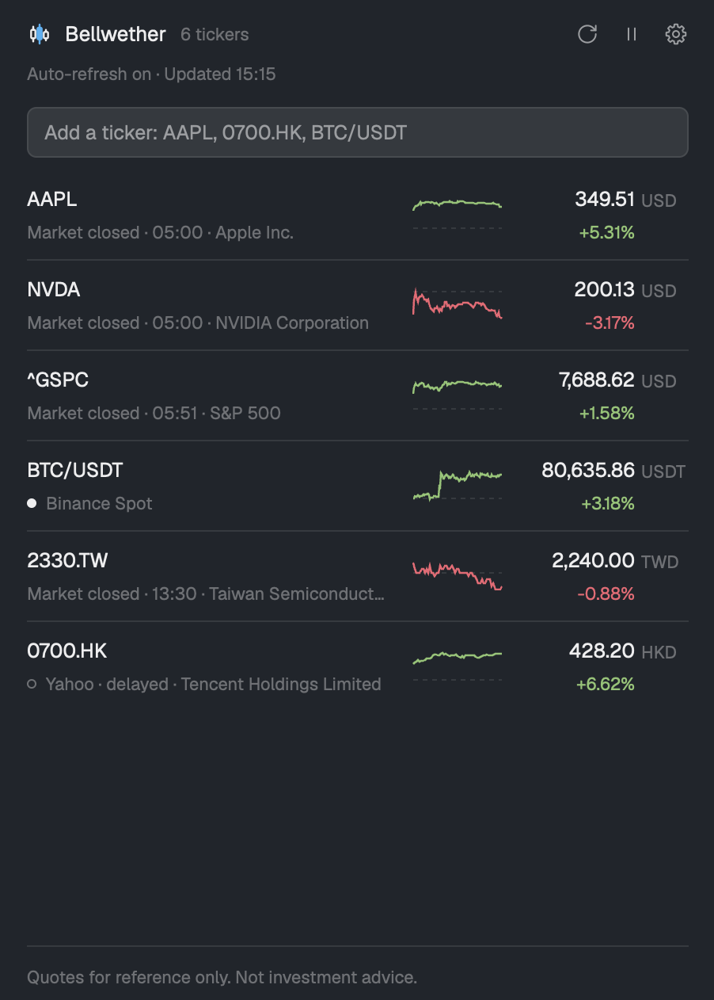

# Wickline — stock & crypto quotes

A stock and crypto watchlist in a pane beside your agents: `ctrl-alt-b` opens it right of the focused terminal. Modified from the Herdr mod in [fatwang2/Pulse](https://github.com/fatwang2/Pulse) (MIT); not affiliated with Pulse. Every ticker shows its price, signed change and today's line; click one for its day: a chart, the open, high, low and previous close, and whether its market is open. Stocks refresh every 60 seconds, crypto pairs every 15, and every row says how fresh its price is. Taiwan stocks can take their price from Yahoo 奇摩股市 (a non-public interface) or TWSE MIS (an unofficial exchange feed), each only after the person turns it on and ticks its own consent box; US stocks from Finnhub, only after the person chooses it and saves their own API key (stored in plaintext in `data/wickline/secrets.json`), for as many symbols as a per-minute request budget allows. The interface speaks English, 繁體中文, 简体中文, 日本語 and 한국어; gains are red in the four Asian languages and green in English unless the person picks otherwise.

## What you see

A panel on the theme's `background` with `foreground` text: under 720px wide, the **sidebar**; from 720px, the **table**; under 72px tall, the **band** (height wins: a block 50px tall and 800px wide is the band); size picks the layout, not placement. The one accent, `theme().accent`, marks only the mark's middle candle, the focused add field's border and the drop line. Gutters 20px left, 28px right, shared by every region. Text is 12.5px (body, symbol, price) or 11px (secondary); the wordmark 13px. Sidebar, top to bottom:

- **Header**, 10px from the top, one 28px line: the 16px mark (`icons/mark-sides.svg` in `foreground` under `icons/mark-center.svg`, the filled middle candle, in `accent`), 8px, `Wickline` (13px semibold), 8px, `5 tickers` (11px `dim`, truncates), then, right-aligned, **refresh**, **pause** (**play** while paused), **settings**, and when a move is possible **open in its own tab** (maximize) or **back beside the terminal** / **back to the panel** (restore). Each a 16px glyph in a 28×28 target, radius 6, `muted`, hover `foreground` on a `hover` fill; tooltips `Refresh`, `Pause`/`Resume`, `Settings`, `Open in its own tab`, `Back beside the terminal`, `Back to the panel` (zh-TW `重新整理`, `暫停`/`繼續`, `設定`, `在自己的分頁開啟`, `回到側邊`, `回到面板`). Targets touch (glyphs 12px apart); the last glyph ends on the content edge.
- **Status line**, 2px under it, plain 11px `dim` text, no dot or animation: `Auto-refresh on · Updated 14:13` (the rows' newest fetch time; no `Updated` before the first quote), `Auto-refresh paused · Updated 14:13`, and `Auto-refresh on · Refreshing quotes…` only during a refresh the person asked for (icon or `wickline.refresh`). Under it, one 11px `blocked` line per source with a problem: `Binance rate limited requests.`, `Yahoo Finance did not answer within 10s.`, `Could not reach Yahoo Finance.`, `Yahoo TW Stock refused the request.`, `Binance is not available in this region. Set another Binance URL in Settings.`, `The TWSE MIS statement has changed. Taiwan stocks do not use it until you confirm it again in Settings.` (Yahoo TW Stock alike), `Finnhub refused the API key. Check it in Settings.`, `Finnhub has no API key. US stocks use Yahoo until you save one in Settings.`, `Could not read the saved Finnhub key file. US stocks use Yahoo until you save the key again in Settings.`
- **Language prompt**, 12px below, until answered: one 11px line `Language: English · 繁中 · 简中 · 日本語 · 한국어 ×`; `Language:` and the `·` in `dim`, names `muted` (`foreground` on hover), the `×` beside the names, not inside one. It names no data source.
- **Add field**, 6px below the prompt (12px below the status line without it): a 32px input, 10px horizontal padding, radius 6, 12.5px text, `selected` fill, its 1px border the fill color at rest (so focus never moves the text) and `accent` while focused; placeholder `Add a ticker: AAPL, 0700.HK, BTC/USDT`. Under it, when needed, one 11px line: an `ansi1` error or the last edit's `dim` notice (`Added AAPL.`; after a removal `Removed AAPL.` then `Undo`, a `muted` link 6px after the text, with no separator). With Finnhub on, an added US symbol pushing another past the cap names it: `Added NVDA. AAPL now uses Yahoo: Finnhub's real-time limit is 15 US symbols.` (`Added NVDA. Finnhub's real-time limit is 0 US symbols, so it uses Yahoo.` when the new symbol is itself past the cap).
- **Market filter**, 10px below the add field (and its notice), only with at least 8 symbols from at least 2 markets (`FILTER_MIN_SYMBOLS`, `FILTER_MIN_MARKETS`): one 24px row between the gutters, `All` then each market on the list, each with its count, in a fixed order by interface language, never by the list (`marketFilters(symbols, lang)`): English: US, Taiwan, Hong Kong, China, Japan, Korea, Crypto, Other; Chinese (both), Japanese and Korean put Taiwan, Japan or Korea first, then that order without it. The counts add up: `All 12 · US 4 · Taiwan 5 · Crypto 3`, `全部 12 · 台股 5 · 美股 4 · 加密 3`. Labels 11px, 10px padding each side, 2px apart: chosen `foreground`, others `muted`, counts `dim`. The chosen one sits on a pill (`selected`, radius 12) that slides to a new choice in 180ms `ease-out` (`transition("left")`, `transition("width")`, from measured label widths; no pill until measured). It scrolls sideways when too wide (`overflow_x_scrollbar`). The band never shows it.
- **Watchlist**, 8px below, the rest of the height, scrolling. One row per ticker in saved order, 8px vertical padding, 2px between lines, `hover` background on hover, a 1px `border` hairline under every row but the last, gutter to gutter:
  - left, three lines in 16, 14 and 14px boxes, drawn even when empty (rows match in height, both sides share baselines): the ticker (semibold, truncates); the instrument name (11px `muted`, truncates at its end: `台積電`, `元大台灣50正2`, `Apple Inc.`); then the freshness dot (6px, filled `foreground` or a 1px `dim` ring) and, in 11px `dim`, the freshness label (both under Freshness) and `As of Oct 31` for a quote from an earlier local day (`10/31` in the other four languages; a closed label carries its own date), joined with ` · `. The label comes first, so a narrow pane cuts the date, never the state. Nothing is said twice (`rowName`): a pair has no name; a name repeating the ticker is dropped; a row without a name keeps line 2 empty.
  - middle, 12px either side: today's line, an area 48px tall, 32px wide, growing with the pane to 120px (from 448px) once the left keeps 150px (`sparkWidth`): a stock's today in 5-minute bars, 1-minute from Yahoo 奇摩股市; a pair's last 24 hours in 15-minute bars; a 1.5px line in the change color over its 16% fill, the previous close a dashed `border` rule.
  - right, a fixed 106px price column (extra width goes to the left): the number right-aligned in 72px (`230.10`, `65,000.00`, `0.00000441`; `foreground`, `dim` when cached), then a 34px currency slot (`USD`, `USDT`; 11px `dim`, 4px in); under it, right-aligned in 11px change color, never cut, the change (`+125.00`) and the change % (`+5.85%`) of one quote, `—` without a previous close. Before the first quote line 1 reads `Waiting…` (`Not fetched` while paused, `Unavailable` after a failure) in 11px `dim`.
  - right gutter (28px): a 16px column, only while hovered, with a 12px `×` (`icons/close.svg`, `dim`, `foreground` on hover, tooltip `Remove`); nothing shifts; then a 12px lane outside the rows, so no row fill reaches it, for the list's scrollbar, which follows the theme.
  - left gutter (20px, full row height), only while hovered: a six-dot grip (`icons/grip.svg`, 14px, `dim`; `foreground` while hovered or dragged); the whole gutter is the grab target (grab cursor, grabbing while dragging). A dragged row gets a `raised` background and a 1px `border` outline; a 2px `accent` line, inset to the gutters, marks the drop: above the row under the pointer's upper half, else below; none when the row would stay put.
  - notes, 11px `blocked`: `Cached quote · <reason>` after a failed refresh kept an older price (the reason alone when there is none); `Showing Yahoo Finance · <reason>` when no real-time price is left (its source failed, or priced outside the limits) and the row shows Yahoo's delayed quote, with the first source's reason in priority order. A US row past Finnhub's cap adds `Over the Finnhub limit of 15: showing Yahoo` in 11px `dim`.
  - Empty: `Your watchlist is empty. Add a ticker above.` in `dim`.
- **Footer**: one line, 10px above and below, under a `border` hairline inset to the gutters: the disclaimer in 11px `dim`, truncated: `Quotes for reference only. Not investment advice.` under 480px wide, `Quotes are third-party data for reference only, not investment advice. See Disclaimer & privacy.` from 480px; a click (hover `foreground`) opens Settings on Disclaimer & privacy.

**Table**, from 720px wide (a pane in its own tab): at most 1280px wide, centered, with the sidebar's gutters, hover controls, hairlines, drag and drop, click-to-detail and footer.

- **Header**, one line: the mark and wordmark, `8 tickers · Auto-refresh on · Updated 14:13` (11px `dim`, truncates first), the add field (320px), the icons. The language prompt, the notice or error and the problem lines go under it (8px, 4px apart).
- **Market filter**: the sidebar's row, 10px below the header or its notes, above the column labels, inside the 1280px frame.
- **Column labels**, 12px below the filter (or header): a 28px line of 11px `dim` labels over a hairline, outside the scrolling list. Numeric labels right-aligned (price over the number, not the currency); status starts past the dot slot.
- **Rows**, 36px, cells 12px apart, in this order: `Symbol` 88px (semibold); `Name` the rest, 120 to 320px (`muted`, truncated; `rowName`); `Status` 128px (the dot in an always-kept 6px slot, then the sidebar's label and date, 11px `dim`); `Today` 120px (the line, an area 120×28); `Price` 112px (number, then the 34px currency slot); `Change` 72px (price units, `+3.58`, change color); `Change %` 64px (change color); `High`, `Low`, `Prev close` 80px each (`muted`; a pair's 24-hour values, `—` for previous close). Notes go on a second line.
- Columns that do not fit (fixed widths, the name at 120px, gaps, gutters) drop in this order: `Prev close`, `Low`, `High`, `Change`, `Today`, `Name`; `Symbol`, `Status`, `Price` and `Change %` always stay. All ten fit from **1100px**; at 720px the table shows symbol, name, status, price and change %.

**Detail dialog**, 440px wide, 18px padding, 14px between parts:

- the ticker (16px semibold) over its name (11.5px `dim`); on the right the session as plain 11px `muted` text, no dot or pill: `Market open`, `Pre-market`, `After hours`, `Market closed`, `Trades 24h` for a pair, `Session unknown` for a stock Yahoo gave no trading hours for; then a `dim` `×` that closes it.
- the price at 26px semibold and the change at 13px in its color.
- a 140px chart across the width: the same line, 2px, over a fill of the change color at 16% opacity, with the dashed previous close.
- four columns, 10.5px `dim` labels over semibold values: Open, High, Low, Prev close (a pair: 24h open, 24h high, 24h low).
- two 11px `dim` lines, 2px apart: the source, `Yahoo Finance · regular session · delayed 15 min` (`delay not provided` when Yahoo reports none; a pair: `Binance Spot · 24h`), or, for a real-time price, state · source: `Price: Live · TWSE MIS · Line: delayed 20 min · Yahoo Finance` (the price alone before Yahoo's first quote), `Price: Live · Yahoo TW Stock · Line: Live · Yahoo TW Stock` (its own line shares the price's state; a stalled price reads `quote stopped at 13:05` in both, a closed market `Market closed`); then `Quote at 15:04:05 · last trade 14:52:10 · Fetched 15:04:12`, the date first when not today, the last trade only for Yahoo TW Stock and when it differs from the quote time. Each ` · ` part (`detailSource`) stays whole; lines wrap only between parts, the `·` ending its line. After a failure, `Cached quote · <reason>` or `Showing Yahoo Finance · <reason>` follows in `blocked`.

**Settings dialog**, 640px by 520px, modal (Esc closes it, a click beside it does not). The settings icon opens the first market page, the footer `Disclaimer & privacy`. Left, a 184px column: `Settings` (13px semibold); the 11px `muted` group label `Data sources` over one 28px item per market, radius 5, in the filter row's order for the language (`US`, `Taiwan`, `Crypto`, `Other`; Taiwan first in Chinese), each with, on the right, a `dot` and `Live` or `Delayed` (11px `dim`) for the draft's choice (`marketStatus`): a source seen failing, its settings unedited, yields to the next one on; when all are failing, a ring and `Problem` in `blocked`, never `Live`. A label in `ansi1` marks a page with an input error. A 10px gap, then `Display` and `Disclaimer & privacy`. Chosen: `hover` fill, `foreground`, semibold; others `muted`. A `border` rule, then the page, 18px padding, scrolling. A footer under a `border` line: an `ansi1` message, at most two lines (a failed save, else the first input error in sidebar order, even on another page), **Cancel** (outlined) and **Save** (`solid` fill, `solid_foreground` text; `hover` fill and `dim` text when disabled) right. Edits wait in a draft until Save; Cancel, Esc or closing drops it.

- **Market pages**, one shape: the 13px semibold title (`United States`, `Taiwan`, `Crypto`, `Other markets`), on the right the dot and `Live · Yahoo TW Stock`, `Delayed 20 min · Yahoo Finance` (`Delayed · Yahoo Finance` outside Taiwan) or `Problem · <source>` in `blocked`. Then `Real-time sources, in order` (11px semibold `muted`): a row per source, its number `dim`, its name semibold, a `muted` 11px kind and a `toggle` on the right (`gpui-base` `Switch`, a 28×16 track in `accent` when on, `border` when off, a 12px `background` knob at the right or left). Under a row, indented: its problem at opening in `blocked`, then its parts while on. Then `When none works`: `Yahoo Finance`, its delay and `Always on`, with Yahoo's problem. Last, `Advanced` (a `›` / `⌄` row): the page's address fields, folded unless opened; held open by a field's error (dim `⌄`) or typing. URL inputs: 30px, radius 6, `input` border, `accent` while focused, `ansi1` when invalid, default address placeholder; checked while shown and on every keystroke, they refuse an address that is not `https://`, has no host, or has a query (`?`) or fragment (`#`); Save trims surrounding spaces.
  - `United States`: `1 Finnhub · Your API key`. On, it reveals `Finnhub API key`. A saved key is never shown: the dialog reads only its last four characters (none under 12 characters; Save waits for that read): `Saved •••• abcd` and **Remove**, which turns the line into `The saved key is removed when you save.` and the button into **Keep**. Below, a masked input (`set_masked(true)`) for a new key, **Show** / **Hide** for what was typed, masked again on blur and page change. With a key saved, the note `Leave the field empty to keep the saved key; a key typed here replaces it when you save.` (after Remove: `With Finnhub chosen it needs a key: type a new one, or turn Finnhub off to remove it.`). With none (or Remove pressed) and the field empty, `Enter your Finnhub API key.` in `ansi1`; a typed key with spaces or control characters inside, or over 128 characters after trimming, shows `A key has no spaces inside and at most 128 characters.`. Every input error disables Save. Then `The key is stored in plaintext on this computer, in data/wickline/secrets.json in Herdr's folder, never in Herdr's shared state. Use a free-plan key.`; `Requests per minute` (default 60; else `Enter a whole number of at least 4.`); `Real time for up to 15 US symbols; the rest use Yahoo.` (budget ÷ 4, live); and `Every open copy of Wickline sends its own requests: with two copies open, the budget runs out twice as fast.` Advanced: `Finnhub URL` (only `https://finnhub.io` plus an optional path: `The Finnhub address must start with https://finnhub.io/ and only the path after it can change.`). Off with a key saved: the `Saved ••••` line and **Remove** stay, with `With Finnhub off the saved key stays. To remove it, press Remove and save, or delete data/wickline/secrets.json.` If `chmod 600` failed after saving, the dialog stays open on this page with `The settings and the key are saved, but chmod 600 failed on data/wickline/secrets.json, …` in `blocked` under the row; Save or Cancel then closes it. The page reads live only with a well-formed typed key, or a saved one not being removed that Finnhub has not refused.
  - `Taiwan`: `1 Yahoo TW Stock · Unofficial`, `2 TWSE MIS · Unofficial`, both off on a fresh install. A switch turned on without the current consent reveals its statement in full, wrapped (11.5px `muted`; only the page scrolls), the note that the Traditional Chinese text prevails and its consent `checkbox` (`gpui-base` `Checkbox`, a 14px box, radius 3, `border` outline, filled `accent` with a `✓` in `background` when ticked, the label semibold); until ticked, `Tick the box to use Yahoo TW Stock.` (or `TWSE MIS.`) in `dim` and Save stays disabled. Once consent to the current version is saved (and still ticked in the draft), the row folds to one line, `✓ Consented · View` (a `muted` text link), which reads `Hide` in place while the statement shows below. Advanced (MIS on): `TWSE MIS URL`.
  - `Crypto`: `1 Binance Spot`, `Always on`, Binance's problem, the region note in `dim` (`Binance may be unavailable in some regions, such as the United States. If so, enter an address that serves the same API.`), then `No other source is used when Binance is unavailable.` in place of the fallback. Advanced: `Binance URL`.
  - `Other markets`: only the fallback row, then `Hong Kong, China, Japan and Korea stocks, indices and currencies use Yahoo Finance only; there is nothing to set.`
- **Display**: `Language` over a segmented control of the five languages in their own names and the `dim` note `Changes only the interface text, not the quotes.`; 8px further, `Gain and loss colors` over a segmented control `Automatic` / `Red up` / `Green up` (1px `border`, radius 6; the chosen segment on `hover` fill, semibold), the `dim` hint `Colors follow you, not the market: one rule for the whole list. Hong Kong usually uses green-up.`, then a button `Open Herdr appearance settings` (closes the dialog, then runs Herdr's `app.settings` with `section: "look"`) and a note that Herdr sets light and dark themes.
- **Disclaimer & privacy**: the disclaimer (third-party quotes, not guaranteed accurate, timely or available; no investment advice; turning on a non-public source or entering a key is the person's own act under its terms; requests go directly from this computer, no server, no telemetry; "A Finnhub key you save is stored in plaintext on this computer."; English prevails), then **Sources**: `Yahoo Finance · Regular-session quotes · Exchange delays vary` and `Binance Spot · Crypto pairs: 24h change`, then the hosts and storage in the README's words, the programs in plain words ("After you save an API key, its file is set so only your account can read it (macOS and Linux). No other programs run."), and the Finnhub note (the budget covers 15 symbols at the default; two copies use it twice as fast).

**Band**: one row: the 14px icon (`icon.svg`, tinted) and `Wickline` in `foreground`, `Paused` in `blocked` if paused, then each ticker as `AAPL ● 230.10 +1.23%` (symbol semibold, the row's dot, no currency, colored change, `cached` in `dim` after a failed refresh), 14px apart, clipped at the right. Empty: `Make the panel taller to add tickers.`

## How it behaves

- Agent status plays no part.
- **First run**: with nothing saved, the list is `AAPL`, `NVDA`, `^GSPC` and `BTC/USDT`. The first edit saves the person's own list; an emptied list stays empty.
- **Language**: English by default and for missing text; the other four cover every label, notice, error and session name; ticker, instrument and source names stay as they are. It never follows the markets or the system. Numbers read the same in every language; times are 24-hour.
- **Language prompt** (not in the band): a name switches to it; `×` keeps the language; either, adding a ticker or choosing in Settings hides it for good, in every copy.
- **Gain/loss colors**: the saved `colors` setting is `auto` (the default), `red-up` or `green-up`. Automatic is red-up (gains `ansi1`, losses `ansi2`) for 繁體中文, 简体中文, 日本語 and 한국어, and green-up (gains `ansi2`, losses `ansi1`) for English. The color follows the change %: one that reads `0.00%` (unsigned, like a `0.00` change) is `muted` in every view.
- **Adding**: Enter adds; input is upper-cased and checked: Yahoo symbols (`AAPL`, `BRK-B`, `^GSPC`, `7203.T`) or Binance pairs as `BASE/QUOTE`. `700.HK` becomes `0700.HK`; `600519.SH` becomes `600519.SS`. Company names and anything URL-like get an inline error; a duplicate says it is there and stays put. A new ticker goes to the top; the field clears.
- **Removing**: `×` removes the ticker and its cached quote at once. For 10 s (`UNDO_MS`) the notice offers Undo: the ticker goes back to its old place (the end, if the list got shorter) in every copy, fading in here, and the notice reads `Restored AAPL.`. Any newer notice ends it; a ticker another copy listed again saves nothing and clears the notice.
- **Reordering**: pressing the handle starts a drag; releasing the left button over the list drops it where the line shows (past the last row: last) and shows `Moved AAPL.`; leaving the list cancels. A drop in front of itself or the next row changes nothing and keeps the notice. Under a filter, a drop lands in front of the visible row dropped on, or, past the last visible row, in front of its successor in the full list (`dropBefore`). The move is judged by symbol against the list saved at the drop: nothing is saved if another copy removed either ticker or the order would not change. The order saves at once and is Finnhub's cap order.
- **Market filter**: a click shows only that market's rows, in list order; fetching never depends on it. A market gone from the list, or a list under the thresholds, reads as `All`; a list that merely got shorter keeps the choice. Dragging never changes the filter. Adding a symbol (new or listed) the filter would hide, or removing the chosen market's last one, goes back to `All` (`filterAfterAdd`, `filterAfterRemove`).
- **Detail**: a click on a row with a quote opens the dialog on that quote as it was; Esc or `×` closes it.
- **Settings**: Save writes only `language`, `colors` and `sources` (and the prompt's answer on a language change) over the settings saved now, keeping keys another copy added; every copy re-renders; a round starts at once when a URL, the budget, `keyRev` or a Yahoo 奇摩股市, MIS or Finnhub switch changed; a switch turned off drops its prices at once. A typed key (Finnhub on) is written trimmed to `data/wickline/secrets.json` (other entries kept, an unreadable file replaced), then `chmod 600`; `keyRev` goes up by one and every copy rereads the file. An empty field keeps the key. Remove then Save deletes the file (`unlink`; other entries are rewritten, protected the same way; an unreadable file is left alone) and raises `keyRev`; Finnhub off without Remove keeps it. If the file cannot be written: `Could not save the Finnhub key.`, and the dialog stays open.
- **Copies**: an edit (add, remove, undo, reorder, pause) shows in every copy at once. An add, remove, undo or pause also restarts that copy's round; a reorder only when it changes which US symbols fit Finnhub's cap.
- **Refreshing**: one loop per source, none holding up another. A round starts right after any edit, then each interval after the last round ends, set by the busiest session among the source's symbols (open, unknown, pre/post, closed; a pair is open):
  - Yahoo every 60 seconds, one stock per request (quote and today's line), at least one second apart.
  - Yahoo 奇摩股市 and TWSE MIS (each when on) every 10 seconds while the Taiwan session is open or unknown, else 60, up to 50 symbols per request. After its prices, Yahoo 奇摩股市 asks lines, one symbol each, only for those just priced: each at most every 2 minutes (10 when not open; after the close, never once it has that day's line), at most 3 per round, longest-waiting first.
  - Binance tickers every 15 seconds, up to 100 pairs per request; each pair's 24-hour line at most every 60 seconds (at once for a new pair or URL). A failed batch is retried pair by pair; a failed line keeps the last one.
  - Finnhub (chosen, with a key) every 15 seconds while the US session is open or unknown, else 60, one request per symbol, spaced `max(1 s, interval / symbols)`, also across rounds.
  - Refresh runs a round of every source but Finnhub (never spending its budget); a source mid-round just continues it (one round, not two), and the status line follows.
  - A docked block not shown (panel collapsed, or another tab of its stack active; a stack with no `active` shows its first child) sends nothing: each loop checks `layout()` before a round and skips it, marking the source missed; the render that shows the block again starts only the missed rounds (`wakeMissed()`); a copy still hidden or yielding wakes nothing. A round already out finishes.
- **Timeouts**: a request that has not answered within 10 seconds fails (`<source> did not answer within 10s.`) and its late answer is dropped.
- **Failures**: a network error or timeout ends that source's round at once (the rest keep their cached quotes with the same reason). A network error, timeout, HTTP error or unreadable answer gives the rows `Cached quote · <reason>` and the source its status line until a clean round; it retries next interval. An unexpected error in a loop shows the source's `unreachable` line and retries; the loop never ends. Binance HTTP 451 is the region error. Any real-time failure (rate limit included) drops that source's price for the symbol at once, for the next source in priority, else Yahoo's quote and a ring; unless the shown price is live, `Showing <source> · <reason>`; never a cached real-time price as live. A Finnhub 401 or 403 ends the round, shows the refused-key line and stops Finnhub until `keyRev` or `sources.us` changes or the copy restarts.
- **Rate limits**: a 429 (Binance also 418, Yahoo 奇摩股市 also 403), on a quote or a line, stops that source's round (a Yahoo 奇摩股市 line's drops all its prices), marks its remaining symbols `Refresh deferred: <source> rate limited requests.`, and holds the source for at least 60 seconds, doubling on repeats up to 15 minutes. Other sources keep their cadence; Refresh respects the cooldown.
- **Stale redraw**: a paused, idle or cooling-down loop sends nothing but still redraws when its newest price passes 120 seconds.
- **TWSE MIS** (off by default): Taiwan symbols (`.TW`, `.TWO`) keep Yahoo's line, session and currency; MIS overlays price, previous close, open, high, low and time, the change taken against MIS's previous close. Its Chinese name (`台積電`) shows in 繁體中文 and 简体中文, also before the first trade (MIS names a row with no price); other languages keep Yahoo's (`displayName`). A copy keeps a symbol's last MIS name in memory while MIS is on, until the symbol is removed. Codes keep their case (`tse_00632R.tw`; lower case gets an empty answer). The price is the last trade (`z`); with no trade in the last 5-second snapshot, the midpoint of the best bid and ask, skipping `0.0000` levels. One side only: a stock locked at its limit is priced at it (asks only, best at limit-down `w`, e.g. bid `-`, ask `0.0000_666.0000_…`, gives `w`; bids only, best at limit-up `u`, gives `u`; both limits present and `u` under 9999); any other one-sided row has no price and no error. Only symbols asked for are accepted. A price outside `w`..`u` from the same answer is discarded (`The TWSE MIS price was outside the stock's daily price limits.`, no status line); a stock without both limits, or `u` at 9999 or more, is not checked. MIS runs only while `sources.tw.mis` is true and `misAck.version` equals `MIS_CONSENT_VERSION` (2); otherwise the status line and Taiwan card ask to confirm again. `provider` (0.3.1's key) is written from `mis` on every save and wins on load (a downgrade keeps the choice).
- **Yahoo 奇摩股市** (off by default): the same overlay for Taiwan symbols, from the fixed `tw.stock.yahoo.com`, with its own switch and consent (`sources.tw.yahootw`, `yahootwAck.version` = `YAHOOTW_CONSENT_VERSION`, 1; a MIS consent never counts). A row is priced only when its price is positive, its trade today in Taipei (UTC+8 by hand) and `exchangeDataDelayedBy` 0; a `-` row gives only its name. A price outside its own `limitDownPrice`..`limitUpPrice` is discarded with a reason; any other rejected row, or a symbol missing from the answer, gives nothing; while open, an answer with prices but none accepted (not `-` only) shows `Yahoo TW Stock returned no real-time prices; other sources are used for now.` until one is. Every priced row is timed at the answer's newest trade (`tradeTime` keeps its own). Its line (today's one-minute closes, a quiet minute carrying the last close, leading empty minutes dropped; `meta.symbol` must match) replaces Yahoo's only while its price is shown and of the line's day, ending at that price. A failed, empty or frozen line (on arrival, its last minute over 2 min before the row's last trade), or losing the price, drops the line; a source failure also shows on the status line until that symbol's next line comes in.
- **Priority**: a Taiwan row shows the first live overlay in `PROVIDERS` order (Yahoo 奇摩股市, then MIS; live = at most 120 s old), else the newer (a tie keeps Yahoo 奇摩股市), else Yahoo Finance. The wait is cut where the shown price turns stale, so a live MIS takes over at that instant.
- **Finnhub** (off by default): US symbols (no suffix, not an index) keep Yahoo's line, session and currency; Finnhub overlays price (`c`), previous close (`pc`), open, high, low and time (`t`, seconds). A `c` or `t` of 0 (unknown symbol) is no price and no error. `BRK-B` is asked as `BRK.B`. It runs only while `sources.us.provider` is `finnhub` and this copy has read a key. Only the first `floor(budgetPerMinute / 4)` US symbols in list order use it (15 at the default 60). The key goes only in the `X-Finnhub-Token` header.
- **Freshness**: each row's dot and label come from the quote's source, its market session (Yahoo's trading hours; a pair trades around the clock) and the quote time:

  | State | When | Dot | Label |
  |---|---|---|---|
  | live | real-time source (Binance, Yahoo 奇摩股市, TWSE MIS, Finnhub), trading, quote at most 120 s old | filled | `Live` (`即時`, `实时`, `リアルタイム`, `실시간`; never a source name, no wider than `Binance Spot`) |
  | unconfirmed | real-time source, session not known yet | ring | the source name (`TWSE MIS`) |
  | stalled | real-time source, trading, quote older than 120 s | ring | `quote stopped at 13:05` |
  | delayed | Yahoo | ring | `delayed 15 min` when Yahoo reports a delay, `delayed 20 min` for Taiwan, otherwise `Yahoo · delayed` |
  | closed | market closed | none | `Market closed · Oct 31 16:00` (the date only when not today) |
  | pre / post | pre-market, after hours (prices are regular-session) | none | `Pre-market`, `After hours` |

  A Yahoo quote is never live, also while its session is unknown.
- **Pause / Resume**: automatic rounds stop and start; Refresh still runs one round while paused. Cached quotes stay.
- **Refresh icon**: from a press or `wickline.refresh` it turns (`spin(900)`, natively) until that refresh ends, in whole turns (stopping upright), at least one per press (a 200 ms round still turns once). A press while it turns adds a turn, no round.
- **Motion**: nothing moves on its own; only the person's actions animate:
  - the filter pill slides (180 ms);
  - a ticker added in this copy fades in (150 ms, `ease-out`);
  - a removed ticker fades out and collapses its height to 0 (150 ms, `ease-out`);
  - a dropped ticker slides from where it was to its new place (150 ms, `ease-out`; it may overlap its neighbour on the way); a cancelled drop or one that changes nothing has no slide.
  - Never animated: rows on the first load, the starter list, a change made in another copy, an automatic round (no flashing prices, no pulsing dot), the band.
- **Open and close**: installing docks and opens nothing. `ctrl-alt-b` opens Wickline as a pane right of the focused terminal, on any layout; pressed again, another copy (each sends its own requests: keep one). Rebind it in the `global` section of `~/.config/herdr-app/keys.json`, or delete that line. Without a key: `herdr-app do pane.split --direction right --mod wickline`. Close it like any pane (the pane header, `pane.close`); Wickline has no zoom.
- **Commands**: `wickline.refresh` and `wickline.pause` (toggle) reach shown copies through `nextCommand()`; neither is bound (the person may bind them in `keys.json`).
- **Own tab**: the maximize icon shows only when a Wickline pane shares the shown tab with another pane. It opens a tab named `Wickline` (`tab.new`, `props: { from: <the pane's tab>, filter }`) whose copy draws the table, and closes the old pane (`pane.close`): one copy keeps fetching. There, the restore icon splits Wickline right (`pane.split`) of a pane of the tab it came from (its focused pane, else its first terminal, else any), else of the focused pane, else of any terminal, never a Wickline pane or one in its own tab, then closes its own pane, never the tab (it goes when empty; a shell split there stays). With nowhere to go back to, the icon is hidden. Dialog copies never draw these icons. The pane copy is the focused Wickline pane in `panes()`, checked at each click.
- **Docked block's own tab**: a shown, non-yielding docked block's maximize icon runs `tab.new` with `props: { dock: true, from: <the person's tab>, filter }` (`dock` checked first: `returnPane` never reads that `from`). Once the new tab's Wickline pane shows up, it stores `shared("wickline.dockTab")` = `{ tab }` and runs `layout.hide` on the collapse node (`dockOf`: the stack, or the wrapper it alone fills, up to the first node with a sibling: `panel` in the office layout; a stack straight in a row collapses alone). The block stays. The tab copy (`props().dock === true`) shows **back to the panel** while the layout has a card block: `layout.select {stack, child: block}`, `layout.show {id: collapse}`, then, once shown, clears `wickline.dockTab` (`{ tab: null }`), selects its `from` tab (`tab.select {id: from}`) while `panes()` lists it (else the focus goes to the neighbour), and runs `pane.close` on the focused Wickline pane, never `tab.close`.
- **Moves wait**: the old copy closes (or the block collapses) only once `panes()` or `layout()` shows the new place: a new Wickline pane outside the old tab (in the target tab going back), one in a tab that did not exist before (`newWicklineTab`; `ctrl-alt-b` into an existing tab never counts), or the panel shown (`isShown`). A task looks every 50 ms for about 1.5 s; failing that, nothing closes, collapses or is stored, and the icon works again. While a move waits, clicks do nothing (`moving`).
- **Yield**: while `blockYields(shared("wickline.dockTab"), panes())` holds (a Wickline pane is in that tab), the docked block draws only `Wickline is open in its own tab.` and a **back to the panel** button, and its `shown()` is false. The button runs the same select, show and wait, then closes that tab's Wickline pane (`panes().find`) and clears the key. A record naming a tab with no Wickline pane never yields, so a Wickline pane opened another way (`ctrl-alt-b`), even in that tab, never makes the block yield; the docked copy clears it once (`staleDockTab`, written only while stale). `dockOf` takes the first card block: Wickline is docked once.
- **Docked card**: a layout block with `"props": {"card": true}` draws all three layouts in the card Herdr's side panels use (`rounded(10)`, `overflow_hidden`, 1px `border`, over `background`). Only the boolean `true` counts (`wantsCard`); panes, the own tab and dialogs never draw one.

## Built from

- **One mod**, `mods/wickline/`, no layout. `mod.json`: `{ "place": "none", "title": "Wickline" }`, so Herdr never docks it on its own. As a pane in any tab: `pane.split {direction: "right", mod: "wickline"}`.
- **`keys.json`** at the repo root, merged into the person's by the install flow: `{ "global": { "ctrl-alt-b": { "command": "pane.split", "args": { "direction": "right", "mod": "wickline" } } } }`. Nothing else is bound.
- **Listing**: the repo root is the listing folder: `mods/wickline/`, `keys.json`, `RECIPE.md`, `preview.png`, `README.md`, `README.zh-TW.md` (same sections), `LICENSE`, `assets/` (`logo-light.svg`, `logo-dark.svg`: the three candles at 96px, side candles `#1f2328` or `#e6edf3`, the middle one `#3a7bd5` in both), `.github/workflows/checks.yml` (tests and a secret scan), `tests/`; no `layouts/`.
- `main.js`: the one `View` (`gpui-kit` `View`; `gpui-base` `v_flex`, `h_flex`, `InputState`), the only module touching Herdr's storage, network, files and commands; everything else outside `ui/` is core (no Herdr, gpui or `fs` imports; Herdr comes in as a host), run by `node --test` with fakes. It picks the mode from `props()`, builds the hosts, runs the loops and the command loop, makes every input (in `init`, a handler or a task, never in `render`) and sizes the panel (`on_size_change`, `layoutFor`). The dialogs are the same mod and start no loop: `openOverlay({ mod: "wickline", kind: "dialog", width: 440, props: { detail: quote } })` (`detailView` in `ui/detail-dialog.js`), and a modal one with `settings: { tab, health }` (`settingsView` in `ui/settings-dialog.js`; the draft, inputs and Save stay on the view).
- `ui/`: functions of the view and theme returning elements (`gpui-kit` `div`, `svg`, `PathBuilder`, `Background`, `window.paint_path`; `gpui-base` `h_flex`, `v_flex`, `Input`, `Checkbox`, `Switch`), no Herdr imports. `ui/panel.js` draws band, sidebar and table, sharing `brand`, `iconButton`, `headerIcons`, `statusText`, `addField`, `messages`, `problemLines`, `rowFrame` (handle, `×`, hairline, drop line), the list and the footer; `ui/parts.js` holds stateless helpers (`chart`, `dot`, `segments`, `button`, `link`, `iconButton`, `segmented`, `checkbox`, `toggle`, `note`).
- Charts: `chartGeometry` (`format.js`) scales a line into `[x%, y%]` points with 8% headroom, the previous close in range; `chart` paints `PathBuilder.stroke(stroke)` for the line (default 2px with the fill, else 1.25px; 1.5px in the sidebar and table), `.dash_array([3, 3])` for the rule and `PathBuilder.fill()` closed along the bottom, each with `window.paint_path(...)` as an absolute layer over a sized `div`.
- `watchlist.js`: the list and the loops. Host: `load`/`save`, `settings`, `fetch`, `loadSecret(name)`, `now`, optional `shown()` (default true; from `layout()` for a docked block). `main.js` runs `runProvider(id, io)` for each of `providerIds()` in its own `cx.spawn`, `io` using that task's `cx.sleep` and `cx.notify()`. Per source: a cooldown (`retryAt`, `failures`) and a problem; `problems()` feeds the status lines and the dialog's `health`. A provider's `cap(config)` limits it to that many symbols in list order (`finnhubSymbols()`, `overCap(symbol)`); `manualRefresh: false` leaves it out of `refreshNow()`; an error with `stopsSource` sets `disabled` until its settings change. The key is read when Finnhub is chosen and `keyRev` changed, kept in memory, added to requests, never to `config()`. An `overlay` provider (Yahoo 奇摩股市, TWSE MIS, Finnhub) writes `overlays[symbol][id]` and `overlayErrors[symbol][id]`, never the base `quotes`; `shown(symbol, now)` = `mergeOverlay(base, pickOverlay(...), line)` (the line: that source's same-day `lines[id][symbol]` or the base's; with `chartSource`); an overlay error deletes that source's overlay. Edits (`restore(symbol, index)` undoes `remove`) are synchronous, bump a revision (a round in flight drops late results) and wake every loop; `sync()` adopts another copy's edit the same way.
- `secrets.js`: `loadSecret`, `loadSecretEnding`, `saveSecret`, `removeSecret`, given `fs/promises`, a `system` (`platform()` from `window().platform`; `chmod(path)`, the one `exec("chmod", ["600", path])`, after each write on `macos` and `linux` only) and the folder (`appHome()` + `/data/wickline`). The file goes with its last key; save and remove resolve false when chmod failed (the key is written all the same).
- `layout.js`: `BAND_MAX_HEIGHT` 72, `TABLE_MIN_WIDTH` 720, `TABLE_MAX_WIDTH` 1280, `GUTTER` 20, `REMOVE_W` 16, `SCROLL_LANE` 12, `RIGHT_INSET` 28, `COLUMN_GAP` 12, `NUMBER_W` 72, `CODE_W` 34, `NAME_ROOM` 150, `sparkWidth(width)` (the sidebar line), `TABLE_COLUMNS` (id, width, alignment), `columnWidth(id)`, `DROP_ORDER`, `layoutFor(size)`, `tableColumns(width)` (the ids that fit, in display order), `nameWidth(width, ids)` (120 to 320px) and `wantsCard`.
- `panes.js`: `returnPane(panes, fromTab, focused, ownTab)`, `canOpenOwnTab`, `ownTabSource`, `newWickline`, `newWicklineTab`, `waitUntil`, `dockOf`, `isShown`, `DOCK_TAB_KEY`, `blockYields`, `staleDockTab`.
- `moves.js`: `ownTabAction` (the own tab or the way back) and `backFromYield` (inside: `dockTabAction`, `backToPanel`, `runMove`, `finishMove`); `syncDock` (from `render`: the block's place, yield and shown state on the view) and `onScreen` (the same for the loops), both clearing a stale `wickline.dockTab`. Host: `panes`, `layout`, `run`, `shared`, `setShared`, `focused`. It runs only `tab.new`, `tab.select`, `pane.split`, `pane.close`, `layout.hide`, `layout.show` and `layout.select`.
- `markets.js`: `marketOf`, `marketOrder(lang)`, `marketFilters(symbols, lang)`, `inFilter`, `visibleSymbols`, `readFilter` (once per render), `filterAfterAdd`, `filterAfterRemove`, `openFilter`, `dropBefore`, `nextOf`.
- `motion.js`: timing (`ROW_MOTION_MS`, `MOTION_GAP_MS`, `MOTION_END_MS`, `SPIN_MS`, `UNDO_MS`), `spinTurnsFor`, `rowsWithGhosts` (a removed row, from data copied before its quote goes, at its measured height and old place, unless the filter hides it) and `settleOffset` (a dropped row starts at `relative().top(from)`, its move in measured row heights). A native `transition` (`opacity`, `height`, `top`) animates only a later change, so `playRow` in `main.js` draws the start value, flips to the end 32 ms later (two `cx.sleep`s), then drops the state.
- `i18n.js`: `LANGUAGES`, `LANGUAGE_LABELS`, `STRINGS` (one table per language, same keys and `{name}` placeholders; English includes `quotes.js`'s error texts) and `t(lang, key, params)` (falls back to English, then the key). The watchlist hands the view `{ code, params }` (a removal's adds `undo`); the view translates when it draws.
- `settings.js`: `readSettings` (every field checked, defaults otherwise), `finnhubChosen`, `misEnabled`, `misReconfirm` (MIS on without the current consent), `yahootwEnabled`, `yahootwReconfirm`, `validateSettings` (field path to error code, `{}` when valid; includes `mis.consentNeeded`, `yahootw.consentNeeded`, `budget.tooSmall`, `finnhub.keyNeeded`), `firstDraftError(errors, markets)` (the first code in page order, or null), `settingsMarkets(lang)` (`SETTINGS_MARKETS` in `marketOrder`), `marketState(settings, market, { keyAvailable })` (`{ live, source }`: the first real-time source on and consented, else Yahoo), `consentGiven(tw, source)` (consent to that source's current statement version; an older one counts as none), `finnhubKeyUsable` (a typed key decides alone, if well formed; else a saved key not being removed and not stopped; an address stop refuses any key), `currentHealth` (the problems seen at opening that still describe the draft: each holds while the settings its source reads are unchanged), `marketStatus` (`marketState` over the draft, plus `problem` when every source it could use is failing, counting only `currentHealth`), `consentCollapsed(saved, draft, source)`, `mergeSettings` (keeps unknown keys, also inside `sources`), `upIsRed`, `SECRET_KEY_FINNHUB` (`finnhub.key`).
- `freshness.js`: `marketSession(quote, now)` (pre, open, post, closed), `sessionOf`, `freshness(quote, session, now)` (the table, pure: `LIVE_MAX_AGE_MS` 120 000, `TAIWAN_YAHOO_DELAY_S` 1200, `REALTIME_SOURCES`), `detailSource`; `format.js` holds `freshnessLabel` and `detailTimes`. The view draws only from them.
- `quotes.js`: symbol rules, error codes with their English texts, the request headers and the cleaners for what a source sends.
- `format.js`: chart geometry, `rowName`, `displayName`, `signed` and `number` (the change and a bare price), `isFlat` and `changeTone` (`0.00%` is neither up nor down), and number, date and time formatting by hand.
- `providers/yahoo.js`, `binance.js` (`BINANCE_URL`), `mis.js`, `yahootw.js` (`YAHOOTW_BASE`, `taipeiDay`), `finnhub.js` (`FINNHUB_URL`, `finnhubSymbol`, `finnhubCap`): per source its host, batching and decoding; `provider.js`: the `Provider` type, `parseJson`, `failEach`.
- `icon.svg`: three candles, one `currentColor` stroke, drawn with `svg("mods/wickline/icon.svg")` and tinted by the text color (band, tab bar).
- `icons/`: `refresh`, `pause`, `play`, `settings`, `zoom` (own tab), `restore` (back), `close`, `grip`, `mark-sides`, `mark-center`: 24×24 viewBox, `stroke="currentColor"` 1.5, round caps and joins, no fill (`grip`: six filled `currentColor` dots), tinted by `text_color`.
- **Storage**: three keys in Herdr's shared state (`shared(...)` / `setShared(...)`, persisted, seen by every copy), one file and one per-copy `localStorage` key:
  - `shared("wickline.watchlist.v1")`: `{ version: 1, symbols: [...], paused }`. The loop re-reads it each round.
  - `shared("wickline.settings.v1")`: `{ version: 1, language: "en"|"zh-TW"|"zh-CN"|"ja"|"ko", colors: "auto"|"red-up"|"green-up", languagePromptDismissed, keyRev, sources: { us: { provider: "yahoo"|"finnhub", finnhubUrl, budgetPerMinute }, tw: { mis, yahootw, misUrl, misAck: { version } | null, yahootwAck: { version } | null, provider: "yahoo"|"mis" }, crypto: { binanceUrl } } }`. Read on every render, field by field; a save keeps keys this build does not know.
  - `shared("wickline.dockTab")`: `{ tab }`, or `{ tab: null }` once cleared (Herdr keeps a value set to `null`): the tab a docked block moved Wickline to.
  - `data/wickline/secrets.json` under Herdr's folder (`appHome()`): `{ "finnhub.key": "<key>" }`, plaintext, written by the settings dialog with `fs/promises` (`mkdir`, `writeFile`, `unlink` on removal), and read by every copy (`exists`, `readFile`). No file means no key; a file that is not a JSON object is a visible problem.
  - `localStorage` key `wickline.filter` (`all`, `us`, `tw`, `hk`, `cn`, `jp`, `kr`, `crypto` or `other`), per copy (Herdr 0.1.12: its own `data/wickline/store-<hash>.json`), each use in a `try`; written only when the person picks. A copy hands its filter on as `props().filter` on every move; a copy with nothing stored uses it (else `all`) without storing it.
  - Quotes and lines are memory only.
- **Network**: `fetch` GETs, headers `User-Agent: Wickline-Herdr/<version>` and `Accept: application/json`, to two hosts always, Yahoo Finance and Binance (`query1.finance.yahoo.com`, `data-api.binance.vision`); `tw.stock.yahoo.com` and TWSE MIS only once the person turns each on and consents, `finnhub.io` only once the person chooses Finnhub and saves a key; also the Binance and MIS URLs the person sets (`https://` only, without a user name, query or fragment; both Binance paths are appended to the saved one). The Finnhub URL keeps the host `finnhub.io`; only its path is editable.
  - `https://query1.finance.yahoo.com/v8/finance/chart/<symbol>?interval=5m&range=1d&includePrePost=false`: `chart.result[0].meta` (`regularMarketPrice`, `regularMarketTime`, `previousClose` else `chartPreviousClose`, `currency`, `longName`/`shortName`, `exchangeDataDelayedBy`, `regularMarketDayHigh`/`Low`, `currentTradingPeriod.pre/regular/post`) and `indicators.quote[0]` (`close` for the line, the first `open`). A response whose `meta.symbol` differs from the request is rejected.
  - `https://data-api.binance.vision/api/v3/ticker/24hr?symbols=["BTCUSDT",...]`: `lastPrice`, `prevClosePrice`, `openPrice`, `highPrice`, `lowPrice`, `closeTime`.
  - `https://data-api.binance.vision/api/v3/klines?symbol=BTCUSDT&interval=15m&limit=96`: closes (index 4) for the 24-hour line.
  - Finnhub (chosen, key saved): `https://finnhub.io/api/v1/quote?symbol=AAPL` (or the saved Finnhub URL with `/quote?symbol=`), header `X-Finnhub-Token: <key>`: `c`, `pc`, `o`, `h`, `l`, `t`.
  - Yahoo 奇摩股市 (on, consented): `https://tw.stock.yahoo.com/_td-stock/api/resource/StockServices.stockList;symbols=2330.TW,6488.TWO`: an array of rows matched on `symbol`, with `symbolName`, `regularMarketTime` (ISO), `exchangeDataDelayedBy` and `{ raw }` values (`-` when none): `price`, `regularMarketPreviousClose`, `regularMarketOpen`, `regularMarketDayHigh`/`Low`, `limitUpPrice`/`limitDownPrice`. Lines: `…/FinanceChartService.ApacLibraCharts;type=tick;symbols=%5B%222330.TW%22%5D`: `[0].chart` with `meta.symbol`, `timestamp` (s) and `indicators.quote[0].close`.
  - MIS (on, consented): `https://mis.twse.com.tw/stock/api/getStockInfo.jsp?ex_ch=tse_2330.tw|otc_6488.tw&json=1&delay=0` (or the saved MIS URL with the same query): `msgArray[]` rows matched on `ex` and `c`, with `z` (last trade, `-` when none), `b`/`a` (best bids and asks, `_`-separated), `y`, `o`, `h`, `l`, `n`, `tlong` (ms), `u`/`w` (limit up and down).
- **Programs**: only `chmod 600` on `data/wickline/secrets.json` right after the key is saved, on macOS and Linux, through Herdr's `exec`, called once in `main.js` and handed to `secrets.js`; no other `exec`, no `hc`, no `process.run`, nothing else. `run("app.settings", { section: "look" })` is a Herdr command, not a program.
- Herdr functions: `theme`, `shared`, `setShared`, `nextCommand`, `props`, `openOverlay`, `closeOverlay`, `run`, `panes`, `layout`, `focused`, `appHome`, `window`, `exec` and `fs/promises`, only as above.

## Watch out

- Disclosure (hosts, programs, storage under Built from): Remove and Save, or deleting `data/wickline/secrets.json`, removes the key here, but backups such as Time Machine may keep it: to revoke it for good, regenerate the key on Finnhub.
- TWSE MIS and Yahoo 奇摩股市 are not APIs offered to third parties (Yahoo's robots.txt disallows automated access to that interface), and nothing about them is promised: never present real-time Taiwan quotes as a feature. Raise `MIS_CONSENT_VERSION` or `YAHOOTW_CONSENT_VERSION` with any change in substance to that source's zh-TW statement or consent (the zh-TW text prevails). Each source lives in its own file (`providers/mis.js`, `providers/yahootw.js`), so one commit can remove it.
- Yahoo 奇摩股市's feed time is per answer (50 symbols each): a batch of only quiet stocks can read stalled while the feed is live (a ring, never a false live price).
- A MIS price for a stock without price limits (`u` 9999.95, no `w`) has nothing to be checked against: only a person can catch a wrong one.
- Anything every copy needs goes through shared state, and the key through its file plus `keyRev`, never through `localStorage` (per copy). Never put the key in `shared()`, a URL, a notice, an error or a log line.
- Finnhub's free plan allows 60 requests a minute: one copy at the default budget uses about half, two shown copies nearly all; a third copy or program on the same key brings 429s. The key goes only to `https://finnhub.io`: each round rechecks the saved URL (shared state may hold one the dialog never accepted, such as `http://finnhub.io`) and, off that host, sends nothing and shows `The saved Finnhub address does not start with https://finnhub.io/ …` on the status line and the United States card. An answer whose final URL is missing or off `https://finnhub.io` (a redirect) is `finnhub.redirected` and stops Finnhub until the US settings change or Herdr restarts; the one redirected request cannot be taken back.
- A saved Binance URL is used as written: whoever edits Herdr's shared state can point crypto requests elsewhere.
- QuickJS, not Node: no `setTimeout`/`setInterval` (use `cx.sleep`), `Intl`, Node APIs or top-level `await`; never keep a `cx` past its callback. `toLocaleString` ignores options: format by hand, prices with grouping and 2 decimals (2 to 4 significant digits below 1), times `HH:MM` (`HH:MM:SS` in the detail), dates `Oct 31` (English) or `10/31`.
- Herdr's `fetch` response has no headers (no `Retry-After`: the 60-second floor stands in) and no timeout or abort: race each request against `cx.sleep` (10 seconds, Timeouts).
- `ctrl-alt-b` is not a Herdr default, but a global binding takes it from terminal programs (some editors use it), and on Windows ctrl+alt is AltGr; the install flow asks before replacing a key.
- `panes()` has no "this copy" (hence the focused Wickline pane; a docked block uses the layout) and lists a pane from `tab.new` or `pane.split` only a little after `run()` returns (hence Moves wait).
- Fill with `background`, not `chrome` (grey in light themes). `hover` and `selected` are translucent, `selected` a step past `hover` (the add field never looks hovered).
- Without `sync()` in `render`, a copy keeps its old list and pause until its next round.
- Binance's quote time is `closeTime`: one that stops moving reads stalled after 120 s, never live.
- A gradient to a fully transparent `#rrggbb00` stop draws as one flat color; use a solid fill with `.opacity(0.16)`.
- Keep `×` beside the clickable row, not inside it.
- No pointer capture: a release outside the list never arrives, so a drag ends on leaving it (`on_hover(false)`). A press sets the target to the row itself, so a click drops nothing.
- Yahoo's chart endpoint is unofficial and regional. `exchangeDataDelayedBy` is mostly 0 or missing even when delayed: never a made-up delay. Never label cached data as fresh or an unknown delay as real time.
- A theme's own `done` color isn't necessarily green: keep the change colors on `ansi2`/`ansi1`.
- `InputState` takes its placeholder only when made, outside `render`: a language change remakes the input (in other copies, from a task their next render wakes), keeping the text and focus.

## Done when

- `herdr-app check mods/wickline` passes.
- Installing changes no layout and opens nothing; `ctrl-alt-b` opens Wickline right of the focused terminal, on `main` and on the person's own layout; a second press opens a second copy; the pane header closes it.
- `node --test tests/` passes: symbols, decoding (recorded MIS answers: midpoint, no price, locked at a limit, limits, case, batches of 50, HTML), the MIS and Yahoo 奇摩股市 gates and overlays (dropped on any failure or when turned off; today, delay, limits and feed time; priority, ties and a 403), Yahoo 奇摩股市 lines (quiet minutes, yesterday, frozen, 3 per round oldest first, a 404 versus a 429), Finnhub (key only in the header and only to `https://finnhub.io`: `http://finnhub.io`, `https://evil.test`, `https://finnhub.io.evil.test` send nothing; a redirected answer stops it, `BRK.B`, the cap and its over-cap notice, a refused key, Refresh, an unreadable key file, the budget), the disclosure in every place, the loops on a fake clock (hangs, timeouts, backoff, region error, recovery), freshness, the session, chart geometry, formatting, the starter list, every language's keys, defensive settings, red-up and dates by language.
- A fresh install shows the language prompt and `AAPL`, `NVDA`, `^GSPC`, `BTC/USDT` with prices and sparklines within seconds; choosing 繁中 switches to Traditional Chinese with gains in red, and the prompt stays gone after a restart.
- A pane 400px wide shows the sidebar; the maximize icon moves Wickline to its own `Wickline` tab, which shows the table (all ten columns at 1100px); the restore icon puts it back right of the terminal it came from and closes the tab.
- Dragging a row by its grip shows the accent line and moves it in every copy, kept after a restart; leaving the list mid-drag drops nothing.
- With 12 symbols (5 Taiwan, 4 US, 3 crypto) the sidebar and the table show the filter row (counts add up) and the band does not; clicking `Taiwan` slides the pill over in about 180ms and shows only the 5 Taiwan rows; dragging one above another keeps the other markets' order; after a restart each copy shows its own choice; with 4 symbols there is no filter row.
- The settings icon opens a modal dialog on the first market page (`台股` in 繁中); an `http://` Binance URL opens Advanced and disables Save with an error; Save with a new language switches every copy at once.
- In 繁中 with TWSE MIS on, a 345px sidebar row reads `2330.TW`, then `台積電`, then `已收盤 · <date> <time>` whole, also when Wickline was opened before the open; `00632R.TW` shows `元大台灣50反1` whole; `AAPL` shows `Apple Inc.` on its own line; `BTC/USDT` keeps line 2 empty. At 280px, `0.00000441` and `+0.00000012` stay whole.
- A layout block with `"props": {"card": true}` beside Herdr's Files draws the card in all three layouts; without it, or as a pane, none.
- With a Taiwan switch on, Save stays disabled until its own consent box is ticked. With only TWSE MIS on, during TWSE hours `2330.TW` then shows a filled dot and `TWSE MIS`, and its detail says `Price: Live · TWSE MIS · Line: delayed 20 min · Yahoo Finance`; an MIS URL that does not answer turns the Taiwan rows back to Yahoo (ring, `delayed 20 min`) with `Showing Yahoo Finance · TWSE MIS did not answer within 10s.` within about 20 seconds.
- With only Yahoo 奇摩股市 on, Save stays disabled until its own box is ticked (a MIS consent never counts); during TWSE hours `2330.TW` shows a filled dot and `Live`, its detail names Yahoo TW Stock, and its line ends at the price shown. With both on, Yahoo 奇摩股市 prices the row; when it stops answering, MIS takes over, and with both off the rows are `delayed 20 min`.
- With Finnhub chosen and a key saved, `~/.config/herdr-app/shared.json` does not contain the key. During US hours `AAPL` shows a filled dot and `Live` (its detail names Finnhub), the 16th US symbol shows the over-cap note, and no 429 appears at the default budget with one copy shown. A wrong key shows the refused-key line and the rows go back to Yahoo.
- On macOS, after saving a key, `ls -l` on `data/wickline/secrets.json` in Herdr's folder shows `-rw-------`. Reopened, the United States page shows `Saved ••••` and the last four characters, never the key; Show unmasks only what was typed and masks it again on leaving the field or the page; Remove and Save deletes the file, Remove and Cancel keeps it. A Finnhub URL hand-edited in `shared.json` to another host shows the bad-address problem and sends no Finnhub request.
